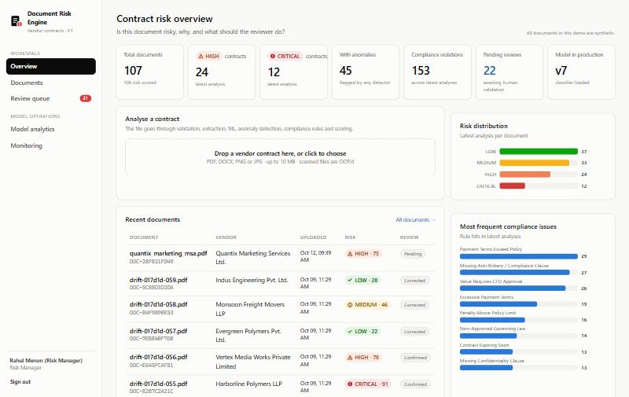
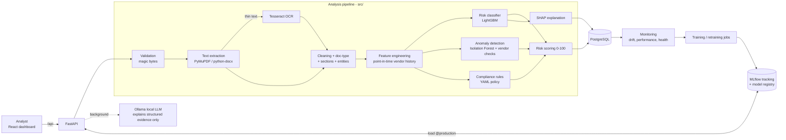
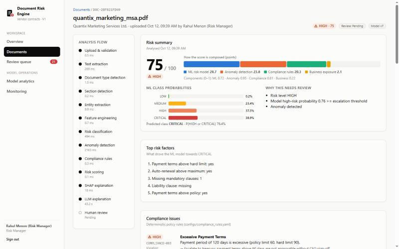
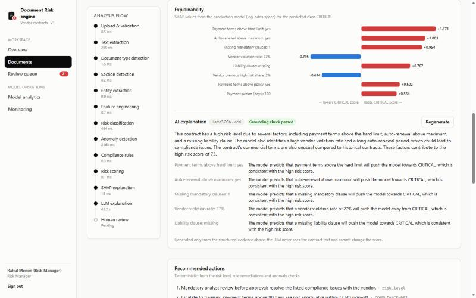
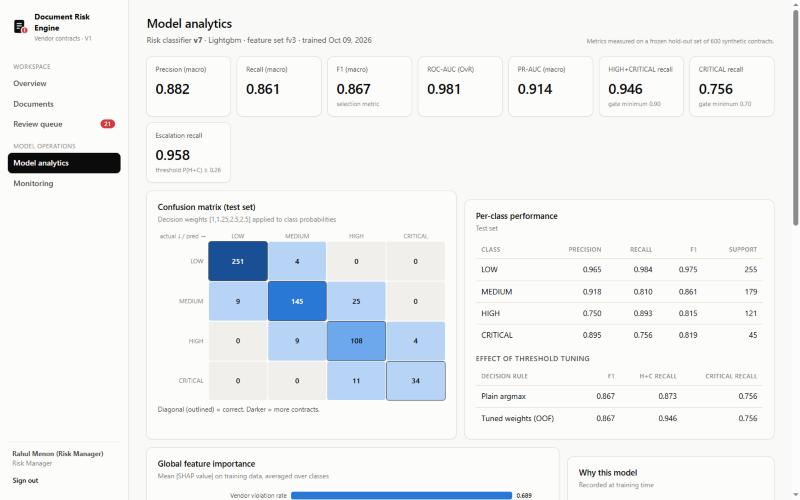
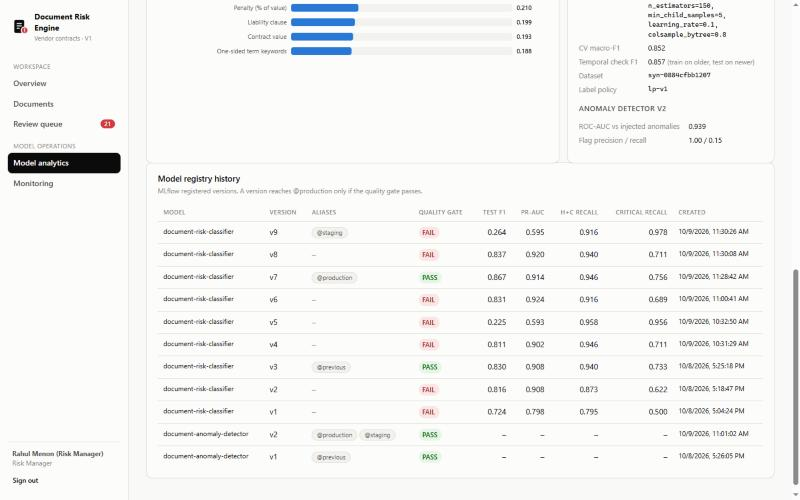
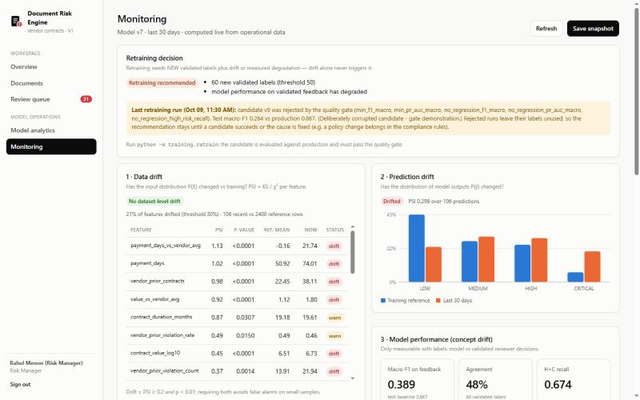

# Document Risk Engine

**Enterprise Document Risk Intelligence & Compliance Engine** — an end-to-end ML system that reads vendor
contracts, extracts their commercial terms, predicts risk, detects anomalies and policy violations, explains
*why*, and learns from validated human review.

> Answers one question for a procurement / compliance analyst:
> **"Is this contract risky, why is it risky, and what should I do about it?"**

> ⚠️ **All data in this project is synthetic.** Contracts are generated by `scripts/generate_dataset.py`
> from fictional vendors. Every metric below was measured on that synthetic corpus and says nothing about
> performance on real enterprise contracts. See [Limitations](#29-limitations).



---

## Contents
1. [Business problem](#1-business-problem) · 2. [Why it matters](#2-why-this-problem-matters) ·
3. [Architecture](#3-architecture) · 4. [Workflow](#4-end-to-end-workflow) · 5. [Tech stack](#5-technology-stack) ·
6. [Document processing](#6-document-processing) · 7. [Features](#7-feature-engineering) ·
8. [Models](#8-ml-model-comparison) · 9. [Anomalies](#9-anomaly-detection) · 10. [Compliance](#10-compliance-engine) ·
11. [Risk score](#11-risk-scoring) · 12. [SHAP](#12-shap-explainability) · 13. [Ollama](#13-ollama-llm-layer) ·
14. [Human-in-the-loop](#14-human-in-the-loop) · 15. [MLflow](#15-mlflow--model-registry) · 16. [Monitoring](#16-monitoring) ·
17. [Retraining](#17-retraining) · 18. [API](#18-api) · 19. [Database](#19-database) · 20. [Dashboard](#20-dashboard) ·
21. [Testing](#21-testing) · 22. [Docker](#22-docker) · 23. [CI/CD](#23-cicd) · 24. [Setup](#24-local-setup) ·
25. [Usage](#25-usage) · 26. [Screenshots](#26-screenshots) · 27. [Results](#27-evaluation-results) ·
28. [Project structure](#28-project-structure) · 29. [Limitations](#29-limitations) · 30. [Future work](#30-future-improvements)

---

## 1. Business problem

Organisations sign thousands of vendor contracts. Manual review is slow, inconsistent and expensive: an
analyst has to find the commercial terms, check them against procurement policy, compare them with the
vendor's history and decide whether to escalate. Missing a contract with unlimited liability or 180-day
payment terms is costly; reviewing every routine contract in full is wasteful.

## 2. Why this problem matters

The system **triages**: it flags the contracts that need attention, shows the evidence (violated rules,
unusual terms, the factors the model weighed), recommends actions, and keeps a human in charge of the final
decision. Reviewer decisions are captured — after a second-person validation — as labels for improving the
model, with monitoring to tell when that is needed.

## 3. Architecture



The core principle: **the LLM never decides risk.** Traditional ML, deterministic rules and anomaly detection
produce structured risk signals; SHAP explains the model; the LLM only turns that evidence into prose and
the system works fully without it.

## 4. End-to-end workflow

Upload → file validation → document-type detection → text extraction → OCR fallback → cleaning → section
detection → entity extraction → feature engineering → risk classification → anomaly detection → compliance
rules → risk scoring → SHAP → Ollama explanation (async) → **human review → validated feedback → retraining →
evaluation → quality gate → MLflow registry → production model**.

Every stage is timed per document and shown in the dashboard's *Analysis flow* rail.

## 5. Technology stack

| Concern | Choice | Why this and not something else |
|---|---|---|
| PDF / DOCX text | PyMuPDF, python-docx | Fast, native text layer; PyMuPDF also rasterises pages for OCR |
| OCR | Tesseract (pytesseract) | Local, free; only used when a page has no text layer |
| Extraction | regex + section context + dateutil | Formulaic fields; exact, auditable, measured at ~99-100% on the synthetic corpus |
| ML | scikit-learn, XGBoost, LightGBM, imbalanced-learn | Tabular features; compared experimentally, LightGBM won on CV |
| Explainability | SHAP (TreeExplainer) | Exact attributions for tree models, tested for additivity |
| LLM | Ollama (`llama3.2:3b`, configurable) | Local, no paid API, optional |
| MLOps | MLflow tracking + registry (aliases) | Experiments, artifacts, versions, @staging/@production |
| Drift | numpy/scipy (PSI, KS, χ²) | Transparent statistics stored in our DB (Evidently considered; see §16) |
| API | FastAPI, Pydantic, SQLAlchemy 2, Alembic | Typed request validation, OpenAPI, migrations |
| Database | PostgreSQL (SQLite for fast tests) | JSONB for structured results; tested on both |
| UI | React 18 + TypeScript + Vite | Hand-built SVG charts, no chart library |
| Ops | Docker Compose, GitHub Actions, JSON logging | Reproducible stack and CI |

spaCy, Evidently, Celery, Kubernetes were deliberately **not** used — each would add weight without
changing an outcome in V1 (reasons in [docs/INTERVIEW_PREP.md](docs/INTERVIEW_PREP.md)).

## 6. Document processing

- **Validation** (`src/ingestion/validation.py`): size limit, extension allow-list, **magic-byte content
  sniffing** (a renamed `.exe` is rejected), extension/content agreement, parser open check (truncated,
  encrypted, zip-bomb DOCX), filename sanitisation.
- **Extraction** (`src/extraction/text_extraction.py`): per page; pages with < 50 characters are rasterised
  at 300 dpi and OCR'd. Methods: `native`, `ocr`, `mixed`, `docx`. OCR failures are reported, never crash.
- **Document type** (`src/preprocessing/doc_type.py`): weighted cue scoring → contract / invoice / PO /
  unknown. Only contracts are scored in V1; invoices get *"Invoice processing is planned for Phase 2."*
- **Sections** (`src/preprocessing/sections.py`): heading patterns + synonym map, with a clause-language
  fallback; offsets stored.
- **Entities** (`src/extraction/entities.py`): 15 fields with value, matched span, confidence and method;
  each field is searched inside its own section first (a 30-day termination notice is never read as the
  payment term). Indian amounts (Lakh/Crore), DD/MM dates, currencies.

**Measured on 3,000 synthetic contracts** (2,083 native, 539 DOCX, 369 OCR, 9 mixed; 0 failures):
field accuracy 99.5–100% overall; on OCR documents vendor name 98.9%, customer name 96.2%.
Document-type accuracy on contracts + invoices + POs: 100%. Templated text makes this far easier than
real contracts.

## 7. Feature engineering

29 features (`configs/features.yaml`, version **fv3**), each declared with name, label, definition, type,
source, transformation and display format. Groups:

- **Contract**: value (log10 INR), duration, payment days, termination notice, renewal months, penalty %,
  days to expiry, non-approved jurisdiction
- **Vendor (point-in-time)**: prior contracts, average value, violation count/rate, prior high-risk share
- **Behavioural**: value vs vendor average, payment days vs vendor average, contracts in last 90 days
- **Text**: missing mandatory clauses, termination/liability/confidentiality presence, unlimited liability,
  one-sided and compliance keyword counts
- **Policy indicators**: payment above policy / hard limit, penalty above policy, expiring within 45 days,
  value above approval limit, auto-renewal above maximum

Vendor features use **only contracts dated before the analysis date** (no leakage). The same builder
runs in training and serving.

## 8. ML model comparison

Labels come from a documented rule policy (`configs/labeling_policy.yaml`) applied to ground truth, so they
are explainable and never random. Distribution: LOW 42.6%, MEDIUM 29.9%, HIGH 20.1%, CRITICAL 7.4%.

Process (`training/train.py`, all runs in MLflow): frozen stratified 80/20 split → **4 families × 3
imbalance strategies** with 5-fold StratifiedKFold → RandomizedSearchCV per family → multi-class
**threshold tuning on out-of-fold predictions** → **constraint-aware selection** (best CV macro-F1 among
models meeting the recall constraints; simpler family wins within 0.01) → test evaluation → quality gate.

| Tuned family (CV, 5 folds) | macro-F1 | HIGH+CRIT recall | CRITICAL recall |
|---|---|---|---|
| Logistic regression | 0.788 | 0.924 | 0.848 |
| Random forest (SMOTE) | 0.834 | 0.921 | 0.781 |
| XGBoost (SMOTE) | 0.835 | 0.921 | 0.764 |
| **LightGBM (SMOTE) — selected** | **0.852** | 0.930 | 0.736 |

Accuracy is never a selection criterion. Full tables, the imbalance grid and the test comparison are in
[docs/EVALUATION_REPORT.md](docs/EVALUATION_REPORT.md).

## 9. Anomaly detection

Kept separate from classification (`src/anomaly/detector.py`):
- **Isolation Forest** on value, payment days, duration, penalty, renewal, contract frequency, value vs
  vendor; scores are training-percentiles, top contributors via SHAP on the forest.
- **Vendor-behaviour checks** against the vendor's own history: robust z-score of value (median/MAD) —
  e.g. *"INR 1.20 Cr is 6.0× this vendor's median"* —, payment terms longer than any previous contract,
  and contract bursts relative to the vendor's normal rate (possible contract splitting).

Measured against injected anomalous scenarios on the test split: Isolation-Forest score ROC-AUC **0.939**;
the flag (97th percentile) is deliberately conservative — precision 1.00, recall 0.15.

## 10. Compliance engine

15 deterministic rules in `configs/compliance_rules.yaml` (id, name, description, severity, type,
condition, message, remediation, enabled, supersedes). Example: `COMPLIANCE-001 Missing Termination
Clause — HIGH`. Conditions are declarative (`all/any/not`, `gt/between/in/missing…`); missing facts never
trigger a violation but raise a data-quality warning. Policy changes are a YAML edit, not a retrain.

## 11. Risk scoring

`risk = 100 × Σ wᵢ·cᵢ` over normalised components: ML expected severity, anomaly, compliance (noisy-OR of
rule severities) and business exposure (value + expiry urgency). Starting weights 40/25/25/10, levels
0–30 / 31–60 / 61–80 / 81–100, guardrail floors (any CRITICAL violation ⇒ at least HIGH) — all
configurable in `configs/risk_scoring.yaml`. A missing component (e.g. model unavailable) is re-weighted
and the result marked **degraded**.

**Weights were validated, not assumed** (`training/validate_weights.py`, 600 test contracts): the default
weights beat 76% of 1,771 weight combinations on rank correlation with policy risk (Spearman 0.906) and
74% on ROC-AUC (0.974), but their level macro-F1 is only 0.577 because fixed thresholds under-call risk;
the ML component alone matches the policy labels best (by construction). The config was not changed — see
the report's §10 for why.

## 12. SHAP explainability

TreeExplainer on the production model: **local** top factors per prediction (shown as a diverging bar
chart) and **global** mean |SHAP| importance. Factors are self-describing (`Termination clause: missing`,
`Payment days vs vendor average: +38 days`). A test asserts SHAP additivity against the real model output.
Top global features: vendor violation rate, missing mandatory clauses, termination clause, unlimited
liability.

## 13. Ollama LLM layer

`src/llm/ollama_client.py` sends **only structured evidence** (score, level, violations, anomalies, SHAP
factors, entities, deterministic actions) — never contract text — with the instruction *"Only explain the
structured evidence supplied by the application. Do not invent contract facts, policies, or risk factors."*
Output is JSON-schema constrained (temperature 0.1) and **post-checked**: explanations of factors not in the
evidence are dropped, numbers not in the evidence and clause-presence contradictions are flagged. It runs as
a background task (~30–45 s on the dev laptop with `llama3.2:3b`); if Ollama is down the explanation status
is `unavailable` and every other result is unaffected (tested).

## 14. Human-in-the-loop

Reviewers **confirm or correct** the risk level (a comment is required for corrections). Each decision stores
document, prediction, model version, score and reviewer. Automatic consistency flags (e.g. *label below HIGH
despite a CRITICAL violation*) are shown to a **second person (risk manager)** who validates or rejects —
reviewers cannot validate their own feedback. Only validated feedback is used for retraining.

## 15. MLflow & model registry

Every experiment, tuned model and training run is tracked (params, CV and test metrics, confusion matrix,
SHAP plot, reference feature distribution, dataset version, feature version, git commit, run note). Models
are registered and moved through aliases — new version → `@staging` → quality gate → `@production`, with the
old one kept as `@previous` for rollback. The API loads `@production` and keeps a last-known-good local copy.
It also **refuses a model whose feature version differs from the serving code**.

**Quality gate** (`configs/quality_gate.yaml`): absolute minimums (macro-F1 0.75, PR-AUC 0.80, HIGH+CRITICAL
recall 0.90, CRITICAL recall 0.70, escalation recall 0.95), maximum regression vs production, identical
feature schema. Real history: of 9 classifier versions, **2 passed** (v3, v7) and 7 were rejected — including
two deliberately corrupted candidates that a recall-only gate would have accepted.

## 16. Monitoring

Four separate questions (`src/monitoring/drift.py`, `/monitoring/summary`, dashboard *Monitoring*):

| | Question | Method |
|---|---|---|
| **Data drift** | Did P(X) change? | PSI + KS (numeric) / χ² (binary) per feature; drift = PSI ≥ 0.2 **and** p < 0.01 |
| **Prediction drift** | Did P(ŷ) change? | PSI of predicted-class distribution vs training reference |
| **Concept drift / performance** | Did P(y\|X) change? | macro-F1 vs *validated* reviewer labels vs the model's test F1 |
| **Service health** | Is the API OK? | p50/p95 latency, 5xx rate, volume per route (from request middleware) |

Implemented with numpy/scipy rather than Evidently so the statistics are unit-tested and stored in our own
tables; Evidently's HTML reports would be a reasonable addition.

## 17. Retraining

`training/retrain.py` runs only when **new validated labels ≥ 50 AND (data drift OR measured degradation)**
(or degradation alone with ≥ 30 labels) — drift alone never triggers it. The candidate is a refit of the
production configuration on train + validated feedback, re-tunes thresholds out-of-fold, is evaluated on the
same frozen test set and goes through the gate.

**Demonstrated end to end** (`python -m scripts.run_demo --reset`, then `python -m training.retrain`):
baseline traffic → no drift; drifted traffic → feature drift (payment days PSI 1.01, p < 0.0001) and
prediction drift (PSI 0.28) but **no retraining** (no labels); reviewer feedback under a changed policy →
macro-F1 on validated labels 0.39 vs 0.87 → retraining triggered → candidate v8 **rejected** (test macro-F1
0.837 vs 0.867). A corrupted candidate (v9) was rejected on five checks.

## 18. API

FastAPI with OpenAPI docs at `/docs`; `X-API-Key` authentication; five roles (compliance / finance /
procurement analyst, risk manager, admin).

| Method | Path | Purpose |
|---|---|---|
| POST | `/documents/upload` | Validate + store (201; 409 duplicate; 413/415/422 rejections) |
| POST | `/documents/{id}/analyze` | Full analysis; returns the risk report |
| GET | `/documents`, `/documents/{id}` | List with filters; detail with entities & sections |
| GET | `/documents/{id}/risk` | Business risk report |
| GET | `/documents/{id}/explanation` | SHAP factors + LLM narrative status |
| POST | `/documents/{id}/feedback` | Confirm / correct |
| GET/POST | `/reviews/queue`, `/feedback`, `/feedback/{id}/validate` | Review queue, four-eyes validation |
| GET | `/analytics/overview` | KPIs |
| GET | `/models/current`, `/models/versions` | Serving model + registry history |
| GET/POST | `/monitoring/summary`, `/monitoring/run`, `/monitoring/history` | Monitoring |
| GET | `/health` | DB / models / OCR / LLM status (503 only if the database is down) |

Example `/risk` (real output for a demo contract):

```json
{"document_id": "DOC-28F821FD49", "risk_score": 75, "risk_level": "HIGH", "ml_predicted_class": "CRITICAL",
 "compliance_violations": [{"rule_id": "COMPLIANCE-003", "rule_name": "Excessive Payment Terms"},
                           {"rule_id": "COMPLIANCE-006", "rule_name": "Missing Liability Clause"},
                           {"rule_id": "COMPLIANCE-011", "rule_name": "Long Auto-Renewal Period"}],
 "top_risk_factors": ["Payment terms above hard limit: yes", "Auto-renewal above maximum: yes",
                      "Missing mandatory clauses: 1", "Liability clause: missing"],
 "needs_review": true, "degraded": false, "model_version": "7"}
```
*(abridged — the full payload also carries probabilities, score components, anomalies, actions and timings)*

Errors are controlled JSON with a `request_id`: database outage → 503 (5 s connect timeout), model
unavailable → degraded result, OCR failure → 422 with the reason.

## 19. Database

PostgreSQL via SQLAlchemy 2 with Alembic migrations (`database/migrations`). Tables: `users`, `documents`,
`document_entities`, `document_features`, `predictions`, `risk_factors`, `anomalies`, `compliance_violations`,
`review_feedback`, `model_versions`, `audit_logs`, plus `vendor_contracts` (point-in-time history),
`request_metrics` and `monitoring_reports`. Raw document text is never stored in the database or audit logs
(a test checks this).

## 20. Dashboard

React + TypeScript (`frontend/`): **Overview** (KPIs, upload, risk distribution, top rule hits), **Documents**
(filters: risk, type, vendor, date, review status), **Document detail** (risk summary → risk factors →
compliance → anomalies → SHAP + LLM → actions → review, with a per-stage timing rail), **Review queue** and
**Feedback validation**, **Model analytics** (metrics, confusion matrix, threshold-tuning effect, global SHAP,
registry history), **Monitoring**. Risk levels always carry an icon + label (never colour alone); charts
follow a validated colour-blind-safe palette.

## 21. Testing

**136 tests** (`pytest`): 81 unit (validation, extraction, features, rules, scoring, anomaly, drift,
retraining policy, quality gate, LLM grounding), 25 ML contract (schema, probability range, required
features, every model family trains and is explainable, **SHAP additivity**), 24 API (all endpoints, roles,
upload rejections, Ollama down, classifier down, database down → 503) and 6 integration (end-to-end
persistence, OCR, point-in-time vendor history, Alembic, **full flow on PostgreSQL**).

```bash
pytest                                                    # SQLite + in-process models
TEST_DATABASE_URL=postgresql+psycopg://... pytest tests/integration/test_postgres.py
```

## 22. Docker

`docker-compose.yml`: `postgres`, `mlflow` (PostgreSQL backend, proxied artifacts), `api`, `dashboard`
(nginx serving the build and proxying `/api`), plus profiles `bootstrap` (data generation + training) and
`llm` (Ollama).

```bash
cp .env.example .env            # set POSTGRES_PASSWORD
docker compose up -d --build
docker compose --profile bootstrap run --rm bootstrap   # first run: ~20-30 min
docker compose restart api
# dashboard http://localhost:8080 · API http://localhost:8000/docs · MLflow http://localhost:5000
```

> **Verification status:** Docker was not available on the development machine, so the compose stack has
> **not** been run end-to-end. What *was* verified: the MLflow server configuration used in compose
> (PostgreSQL backend store, proxied artifacts, `--allowed-hosts`) with our registry code over HTTP; the
> Dockerfile's sources and scripts statically. CI builds both images on every push.

## 23. CI/CD

`.github/workflows/ci.yml` — **lint** (ruff) · **test** (Tesseract installed, PostgreSQL service; unit, ML,
API, integration; Alembic migration drift check) · **frontend** (`npm ci`, typecheck, build) · **docker**
(compose config validation, backend + dashboard image builds, import smoke test). No deployment workflow —
there is no deployment target to deploy to. *The workflow has not yet run on GitHub; every command in it has
been run locally except the Docker build.*

## 24. Local setup

Prerequisites: Python 3.12, Node 20+, Tesseract on `PATH`, optional Ollama.

```bash
python -m venv .venv && .venv/Scripts/activate        # Windows (Linux/macOS: source .venv/bin/activate)
pip install -r requirements-dev.txt
cp .env.example .env
# Database: point DATABASE_URL at PostgreSQL. Without Docker:
pip install pgserver && python -m scripts.local_postgres --write-env --keep-alive   # keep running
# Data + models (~25 min)
python -m scripts.generate_dataset --n-contracts 3000 --n-vendors 200
python -m training.build_dataset
python -m training.train
python -m training.train_anomaly
python -m scripts.init_db          # migrations, demo users (keys -> artifacts/demo_api_keys.json), vendor history
# Run
uvicorn api.main:app --port 8000
npm --prefix frontend install && npm --prefix frontend run dev    # http://localhost:5173
ollama pull llama3.2:3b && ollama serve                           # optional
```

On Windows consoles, set `PYTHONIOENCODING=utf-8` when piping MLflow output.

## 25. Usage

1. Sign in with a key from `artifacts/demo_api_keys.json` (one user per role).
2. Drop a contract on the Overview page → you land on its analysis.
3. Review it (confirm/correct); a risk manager validates under *Review queue → Feedback validation*.
4. `python -m scripts.run_demo --reset` reproduces the full monitoring / drift / concept-drift story;
   `python -m training.retrain` runs the retraining job; `--force --simulate-bad-candidate` shows the gate
   rejecting a corrupted model.
5. `python -m training.validate_weights` and `python -m training.report` regenerate the evaluation evidence.

## 26. Screenshots

| | |
|---|---|
|  |  |
| Risk summary, score composition, analysis-flow timings | SHAP factors + grounded local-LLM narrative |
|  |  |
| Test metrics, confusion matrix, threshold-tuning effect | Every registered version and its gate outcome |
|  | |
| Data drift, prediction drift, performance, retraining decision | |

## 27. Evaluation results

Production model **v7 — LightGBM (SMOTE, tuned decision weights)**, frozen test set of 600 synthetic
contracts:

| Metric | Value | | Metric | Value |
|---|---|---|---|---|
| macro-F1 | **0.867** | | HIGH+CRITICAL recall | **0.946** |
| macro precision | 0.882 | | CRITICAL recall | 0.756 |
| macro recall | 0.861 | | escalation recall (P(H+C) ≥ 0.26) | 0.958 |
| ROC-AUC (OvR macro) | 0.981 | | temporal check macro-F1 (train old / test new) | 0.857 |
| PR-AUC (macro) | 0.914 | | accuracy (reference only) | 0.897 |

Threshold tuning on out-of-fold predictions raised HIGH+CRITICAL recall from 0.873 (argmax) to 0.946 at the
same macro-F1. Disclosure: v7 was trained after v6 narrowly failed the gate (see the report §8). Full report:
**[docs/EVALUATION_REPORT.md](docs/EVALUATION_REPORT.md)** · EDA: [docs/EDA.md](docs/EDA.md).

## 28. Project structure

```
document-risk-engine/
├── api/                 FastAPI app, routers, auth, services, monitoring service
├── configs/             features, labeling policy, compliance rules, risk scoring, quality gate, anomaly, monitoring, training
├── database/            SQLAlchemy models, session, Alembic migrations
├── frontend/            React + TypeScript dashboard (Vite, nginx Dockerfile)
├── scripts/             dataset generation, demo, traffic simulation, DB init, local Postgres, docker scripts
├── src/
│   ├── ingestion/  extraction/  preprocessing/  features/  models/  anomaly/
│   ├── compliance/  scoring/  explainability/  llm/  monitoring/  feedback/
│   ├── pipeline/        document processor, analyzer, model service
│   └── synthetic/       contract generator, renderer, labeling policy
├── training/            build_dataset, eda, train, train_anomaly, retrain, validate_weights, report, diagnose_labels
├── tests/               unit/ ml/ api/ integration/
├── docs/                EVALUATION_REPORT.md, EDA.md, INTERVIEW_PREP.md, images/
├── Dockerfile  docker-compose.yml  .github/workflows/ci.yml
```

## 29. Limitations

- **Synthetic data.** Templated contracts and a known labeling policy make extraction and classification
  much easier than reality; the model learns the policy, not analyst judgement.
- **Small CRITICAL class** (45 test contracts): recall estimates carry ~6–7 points of standard error, so gate
  decisions near a threshold are noisy.
- **Concept drift from policy changes** is better handled by editing the compliance rules than by retraining on
  a few dozen labels — the retraining demo shows candidates failing to learn it.
- Rule-based extraction will not generalise to arbitrary real contract layouts; static FX rates; English /
  Indian conventions only; vendor identity by normalised name (no vendor master / tax ID).
- Synchronous analysis in the request; single-node; Docker stack unverified locally (see §22).

## 30. Future improvements

- Real (or public) contracts and reviewer-labelled data; calibrate level thresholds on validated labels.
- Layout-aware extraction (e.g. a document AI model) with the current rules as a fallback.
- Async processing queue (e.g. Celery/RQ + object storage) for bulk uploads.
- Bootstrap confidence bounds in the quality gate; shadow / canary deployment before promotion.
- Invoices and purchase orders (Phase 2), three-way matching against contracts.
- SSO/OIDC, encryption at rest for uploads, retention policies.
