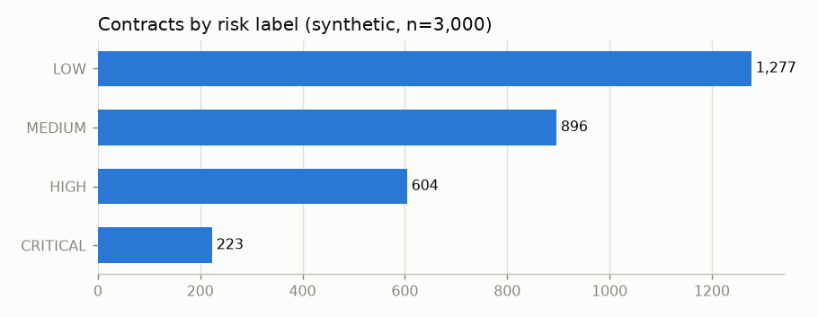
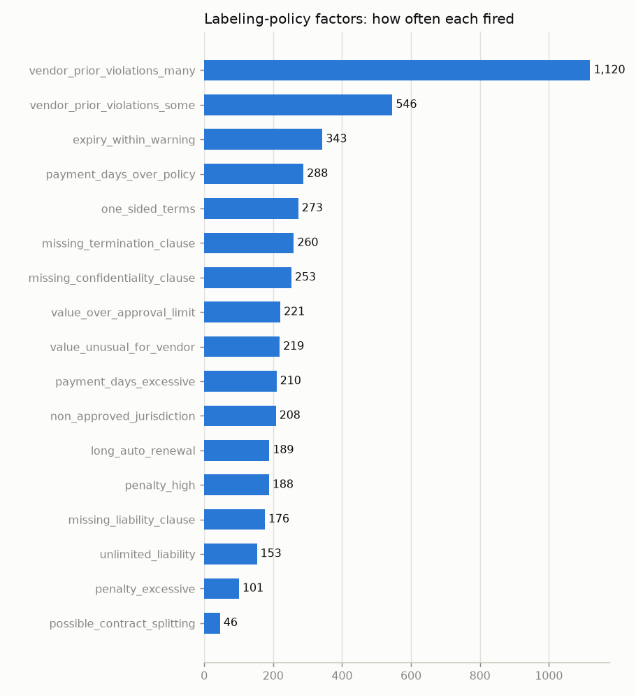

# Exploratory Data Analysis

> **All data is synthetic** (generated by `scripts/generate_dataset.py`). Numbers below describe the
> synthetic corpus only and say nothing about real enterprise contracts.

Dataset version `syn-0884cfbb1207`, feature version `fv3`, 3,000 contracts, 201 distinct vendors (as extracted), submission dates 2023-01-02 to 2026-09-29.

## 1. Label distribution

| risk_label   |   share |   count |
|:-------------|--------:|--------:|
| LOW          |   0.426 |    1277 |
| MEDIUM       |   0.299 |     896 |
| HIGH         |   0.201 |     604 |
| CRITICAL     |   0.074 |     223 |

CRITICAL is the minority class (the imbalance the modelling phase must handle).

## 2. Labeling-policy factors

## 3. Extraction quality vs ground truth (accuracy by extraction method)

|                                 |   all |   native |   docx |   ocr |
|:--------------------------------|------:|---------:|-------:|------:|
| vendor_name                     | 0.999 |        1 |      1 | 0.989 |
| customer_name                   | 0.995 |        1 |      1 | 0.962 |
| contract_number                 | 1     |        1 |      1 | 0.997 |
| start_date                      | 1     |        1 |      1 | 1     |
| end_date                        | 1     |        1 |      1 | 0.997 |
| contract_value                  | 1     |        1 |      1 | 1     |
| currency                        | 1     |        1 |      1 | 1     |
| payment_days                    | 1     |        1 |      1 | 1     |
| termination_notice_days         | 1     |        1 |      1 | 1     |
| penalty_pct                     | 0.999 |        1 |      1 | 0.997 |
| renewal_months                  | 1     |        1 |      1 | 1     |
| governing_law                   | 1     |        1 |      1 | 1     |
| termination_clause_presence     | 1     |        1 |      1 | 1     |
| liability_clause_presence       | 1     |        1 |      1 | 1     |
| confidentiality_clause_presence | 1     |        1 |      1 | 1     |
| compliance_clause_presence      | 1     |        1 |      1 | 1     |
| unlimited_liability             | 1     |        1 |      1 | 1     |

Document-type detection accuracy on 3080 documents (contracts + invoices + POs): **1.000**.

Caveat: the synthetic contracts use a finite set of templates, so extraction is far easier than on
real contracts. OCR documents show the expected small drop (character errors in names).

## 4. Extraction method by risk label

| extraction_method   |   LOW |   MEDIUM |   HIGH |   CRITICAL |
|:--------------------|------:|---------:|-------:|-----------:|
| docx                |   234 |      160 |    100 |         45 |
| mixed               |     3 |        5 |      1 |          0 |
| native              |   879 |      623 |    429 |        152 |
| ocr                 |   161 |      108 |     74 |         26 |

## 5. Missing feature values

|                              |   missing_share |
|:-----------------------------|----------------:|
| termination_notice_days      |           0.087 |
| vendor_prior_high_risk_ratio |           0.067 |
| vendor_prior_avg_value_log10 |           0.067 |
| vendor_prior_violation_rate  |           0.067 |
| value_vs_vendor_avg          |           0.067 |
| payment_days_vs_vendor_avg   |           0.067 |
| penalty_pct                  |           0     |

Missingness is structural, not random: vendor-history features are NaN for a vendor's first
contract, `termination_notice_days` is NaN when no termination clause exists.

## 6. Feature medians by risk label

|                              |    LOW |   MEDIUM |   HIGH |   CRITICAL |
|:-----------------------------|-------:|---------:|-------:|-----------:|
| contract_value_log10         |   6.45 |     6.54 |   6.64 |       6.81 |
| contract_duration_months     |  23.95 |    23.95 |  23.95 |      23.95 |
| payment_days                 |  45    |    45    |  45    |      60    |
| termination_notice_days      |  30    |    30    |  30    |      30    |
| renewal_months               |   0    |     0    |   0    |      12    |
| penalty_pct                  |   5    |     5    |   5    |       5    |
| days_to_expiry               | 390    |   392    | 379.5  |     368    |
| non_approved_jurisdiction    |   0    |     0    |   0    |       0    |
| vendor_prior_contracts       |   6    |     9    |  15    |      24    |
| vendor_prior_avg_value_log10 |   6.5  |     6.58 |   6.7  |       6.74 |
| vendor_prior_violation_count |   2    |     4    |  10    |      18    |
| vendor_prior_violation_rate  |   0.32 |     0.5  |   0.76 |       0.78 |
| vendor_prior_high_risk_ratio |   0    |     0.17 |   0.5  |       0.67 |
| value_vs_vendor_avg          |   0.92 |     0.85 |   0.81 |       0.98 |
| payment_days_vs_vendor_avg   |  -3    |    -7.5  |  -8.7  |       0    |
| vendor_contracts_last_90d    |   1    |     1    |   2    |       4    |
| missing_clause_count         |   0    |     0    |   0    |       1    |
| has_termination_clause       |   1    |     1    |   1    |       1    |
| has_liability_clause         |   1    |     1    |   1    |       1    |
| has_confidentiality_clause   |   1    |     1    |   1    |       1    |
| unlimited_liability          |   0    |     0    |   0    |       0    |
| risk_keyword_count           |   0    |     0    |   0    |       0    |
| compliance_keyword_count     |   5    |     5    |   5    |       5    |
| payment_above_policy         |   0    |     0    |   0    |       0    |
| payment_above_hard_limit     |   0    |     0    |   0    |       0    |
| penalty_above_policy         |   0    |     0    |   0    |       0    |
| expiry_within_warning        |   0    |     0    |   0    |       0    |
| value_above_approval_limit   |   0    |     0    |   0    |       0    |
| renewal_above_max            |   0    |     0    |   0    |       0    |

## 7. Spearman correlation of each feature with policy risk points

|                              |   spearman_rho |
|:-----------------------------|---------------:|
| vendor_prior_high_risk_ratio |          0.607 |
| vendor_prior_violation_rate  |          0.579 |
| missing_clause_count         |          0.516 |
| vendor_prior_violation_count |          0.508 |
| has_termination_clause       |         -0.386 |
| vendor_prior_contracts       |          0.351 |
| vendor_contracts_last_90d    |          0.323 |
| payment_above_policy         |          0.311 |
| payment_above_hard_limit     |          0.307 |
| unlimited_liability          |          0.303 |
| expiry_within_warning        |          0.3   |
| penalty_above_policy         |          0.279 |
| payment_days                 |          0.269 |
| has_liability_clause         |         -0.269 |
| has_confidentiality_clause   |         -0.249 |
| contract_value_log10         |          0.246 |
| value_above_approval_limit   |          0.243 |
| vendor_prior_avg_value_log10 |          0.243 |
| non_approved_jurisdiction    |          0.216 |
| renewal_above_max            |          0.211 |
| compliance_keyword_count     |         -0.189 |
| penalty_pct                  |          0.165 |
| risk_keyword_count           |          0.164 |
| days_to_expiry               |         -0.147 |
| renewal_months               |          0.084 |
| payment_days_vs_vendor_avg   |         -0.045 |
| value_vs_vendor_avg          |         -0.022 |
| termination_notice_days      |          0.012 |
| contract_duration_months     |          0.006 |
