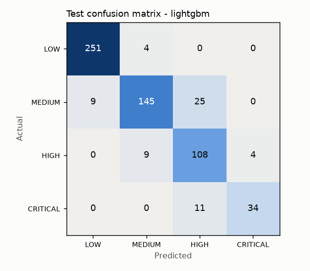
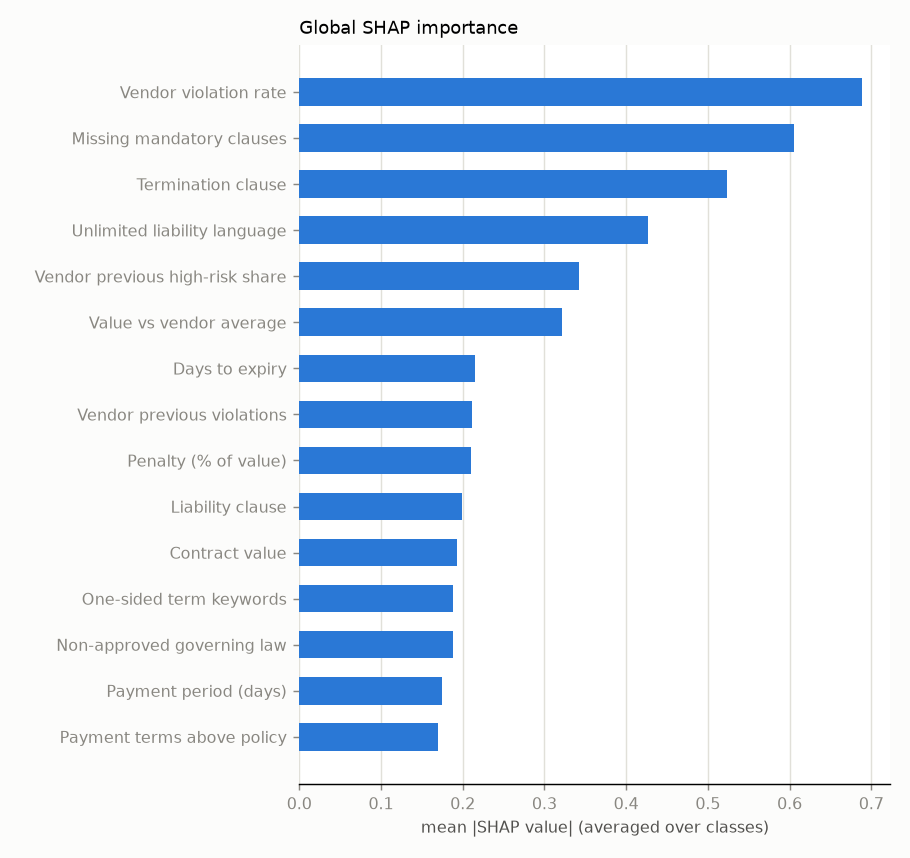

# Evaluation Report - Document Risk Engine (V1, vendor contracts)

> **All data is synthetic.** Every number below is generated by `python -m training.report` from the
> artifacts of the actual runs and from the MLflow registry. They describe performance on a synthetic
> corpus with a known labeling policy and **do not** represent real enterprise performance.

## 1. Dataset

- Corpus: 3,000 synthetic vendor contracts (dataset version `syn-0884cfbb1207`), rendered as PDF / DOCX / scanned PDF / PNG / JPG: {'pdf': 2092, 'docx': 539, 'scan_pdf': 183, 'png': 132, 'jpg': 54}.
- Every document went through the production extraction pipeline (OCR for scans); 0 extraction failures; method mix {'native': 2083, 'docx': 539, 'ocr': 369, 'mixed': 9}.
- Plus 80 invoices / purchase orders for document-type detection (accuracy **1.000**).
- Feature set `fv3`: 29 features (see `configs/features.yaml`).
- Split: frozen stratified hold-out, 2400 train / 600 test (`data/processed/split.json`); every candidate is evaluated on the same test contracts.

### Label distribution (labeling policy `lp-v1`, `configs/labeling_policy.yaml`)

| level | count | share |
|---|---|---|
| LOW | 1277 | 42.6% |
| MEDIUM | 896 | 29.9% |
| HIGH | 604 | 20.1% |
| CRITICAL | 223 | 7.4% |

### Extraction accuracy vs ground truth

| field | all | native PDF | DOCX | OCR |
|---|---|---|---|---|
| vendor_name | 0.999 | 1.000 | 1.000 | 0.989 |
| customer_name | 0.995 | 1.000 | 1.000 | 0.962 |
| contract_number | 1.000 | 1.000 | 1.000 | 0.997 |
| start_date | 1.000 | 1.000 | 1.000 | 1.000 |
| end_date | 1.000 | 1.000 | 1.000 | 0.997 |
| contract_value | 1.000 | 1.000 | 1.000 | 1.000 |
| currency | 1.000 | 1.000 | 1.000 | 1.000 |
| payment_days | 1.000 | 1.000 | 1.000 | 1.000 |
| termination_notice_days | 1.000 | 1.000 | 1.000 | 1.000 |
| penalty_pct | 0.999 | 1.000 | 1.000 | 0.997 |
| renewal_months | 1.000 | 1.000 | 1.000 | 1.000 |
| governing_law | 1.000 | 1.000 | 1.000 | 1.000 |
| termination_clause_presence | 1.000 | 1.000 | 1.000 | 1.000 |
| liability_clause_presence | 1.000 | 1.000 | 1.000 | 1.000 |
| confidentiality_clause_presence | 1.000 | 1.000 | 1.000 | 1.000 |
| compliance_clause_presence | 1.000 | 1.000 | 1.000 | 1.000 |
| unlimited_liability | 1.000 | 1.000 | 1.000 | 1.000 |

Templated synthetic text makes extraction far easier than real contracts; OCR shows the expected small drop.

### Label observability: 95.6% of labels can be reconstructed from extracted features alone (`training/diagnose_labels.py`). The remaining gap comes from factors that need information the features don't carry (e.g. contract splitting).

## 2. Experiment 1 - model family x class-imbalance strategy (5-fold StratifiedKFold on train)

| family | imbalance | macro-F1 | macro PR-AUC | HIGH+CRIT recall | CRITICAL recall | accuracy |
|---|---|---|---|---|---|---|
| logistic_regression | none | 0.7849 | 0.8622 | 0.874 | 0.809 | 0.786 |
| logistic_regression | class_weight | 0.7822 | 0.8574 | 0.906 | 0.899 | 0.778 |
| logistic_regression | smote | 0.7828 | 0.8596 | 0.917 | 0.910 | 0.776 |
| random_forest | none | 0.7875 | 0.8816 | 0.817 | 0.539 | 0.844 |
| random_forest | class_weight | 0.7779 | 0.8701 | 0.832 | 0.478 | 0.843 |
| random_forest | smote | 0.8130 | 0.8964 | 0.846 | 0.680 | 0.852 |
| xgboost | none | 0.8028 | 0.8723 | 0.829 | 0.573 | 0.857 |
| xgboost | class_weight | 0.8106 | 0.8745 | 0.856 | 0.629 | 0.861 |
| xgboost | smote | 0.8278 | 0.8881 | 0.852 | 0.652 | 0.873 |
| lightgbm | none | 0.8293 | 0.9021 | 0.853 | 0.652 | 0.873 |
| lightgbm | class_weight | 0.8341 | 0.9037 | 0.861 | 0.713 | 0.874 |
| lightgbm | smote | 0.8457 | 0.9096 | 0.864 | 0.719 | 0.882 |

Accuracy is shown for reference only and never used for selection. Observations: SMOTE helps the tree models most on CRITICAL recall; class weights help logistic regression; argmax decisions leave tree models short on CRITICAL recall - which is what threshold tuning addresses.

## 3. Experiment 2 - hyper-parameter search (RandomizedSearchCV, 20 iterations, scoring = macro-F1)

Each family uses its best imbalance strategy from Experiment 1. Decision weights (multi-class threshold moving, `argmax(p * w)`) are tuned on **out-of-fold** probabilities to maximise macro-F1 subject to HIGH+CRITICAL recall >= 0.9 + margin and CRITICAL recall >= 0.7 + margin.

| family | imbalance | CV F1 (argmax) | CV F1 (tuned) | HIGH+CRIT recall | CRITICAL recall | decision weights | meets constraints | best params |
|---|---|---|---|---|---|---|---|---|
| logistic_regression | none | 0.7875 | 0.7876 | 0.924 | 0.848 | [1.0, 1.25, 2.5, 3.0] | yes | C=10.0 |
| random_forest | smote | 0.8246 | 0.8340 | 0.921 | 0.781 | [1.0, 1.25, 2.0, 2.5] | yes | n_estimators=200, min_samples_leaf=1, max_features=0.5, max_depth=None |
| xgboost | smote | 0.8386 | 0.8354 | 0.921 | 0.764 | [1.0, 1.0, 2.0, 4.0] | yes | subsample=0.7, reg_lambda=0.5, n_estimators=500, min_child_weight=1, max_depth=3, learning_rate=0.05, colsample_bytree=0.8 |
| lightgbm | smote | 0.8570 | 0.8520 | 0.930 | 0.736 | [1.0, 1.25, 2.5, 2.5] | yes | subsample_freq=1, subsample=0.7, reg_lambda=0.0, num_leaves=7, n_estimators=150, min_child_samples=5, learning_rate=0.1, colsample_bytree=0.8 |

## 4. Model selection

**Rule (pre-declared in `configs/training.yaml`):** among families meeting the recall constraints in CV, take the best CV macro-F1; within 0.01, prefer the simpler family.

**Outcome:** 4/4 tuned families meet the CV recall constraints (HIGH+CRITICAL and CRITICAL recall). Best CV f1_macro among them = 0.8520. Within 0.01: ['lightgbm']. Chose the simplest: lightgbm (f1_macro = 0.8520).

Selected: **lightgbm** (smote), decision weights [1.0, 1.25, 2.5, 2.5], escalation threshold P(HIGH)+P(CRITICAL) >= 0.26 (OOF recall 0.952, precision 0.838, review rate 0.313).

## 5. Test-set results (frozen hold-out, never used for selection or tuning)

| metric | value |
|---|---|
| precision_macro | 0.8820 |
| recall_macro | 0.8606 |
| f1_macro | 0.8674 |
| roc_auc_ovr_macro | 0.9806 |
| pr_auc_macro | 0.9145 |
| high_risk_recall | 0.9458 |
| high_risk_precision | 0.8626 |
| critical_recall | 0.7556 |
| escalation_recall | 0.9578 |
| escalation_precision | 0.8413 |
| accuracy | 0.8967 |

| class | precision | recall | f1 | support |
|---|---|---|---|---|
| LOW | 0.965 | 0.984 | 0.975 | 255 |
| MEDIUM | 0.918 | 0.810 | 0.861 | 179 |
| HIGH | 0.750 | 0.893 | 0.815 | 121 |
| CRITICAL | 0.895 | 0.756 | 0.819 | 45 |

### Effect of threshold tuning on the test set

| decision rule | macro-F1 | HIGH+CRIT recall | CRITICAL recall |
|---|---|---|---|
| plain argmax | 0.8673 | 0.873 | 0.756 |
| tuned weights [1.0, 1.25, 2.5, 2.5] | 0.8674 | 0.946 | 0.756 |

### Temporal robustness check (train on the oldest 80%, test on the newest 20%)

macro-F1 0.8569, HIGH+CRITICAL recall 0.931 (train until 2026-01-03, test from 2026-01-03).

### All tuned families on the test set (transparency only)

| family | macro-F1 | PR-AUC | ROC-AUC | HIGH+CRIT recall | CRITICAL recall |
|---|---|---|---|---|---|
| logistic_regression | 0.8047 | 0.8747 | 0.9560 | 0.946 | 0.867 |
| random_forest | 0.8312 | 0.9238 | 0.9775 | 0.916 | 0.689 |
| xgboost | 0.8732 | 0.9171 | 0.9787 | 0.940 | 0.867 |
| lightgbm | 0.8674 | 0.9145 | 0.9806 | 0.946 | 0.756 |

Selection used cross-validation only. If another family scores higher here, switching to it now would be selecting on the test set, which would make the reported test numbers optimistic - so it is not done.

## 6. Quality gate (`configs/quality_gate.yaml`)

| check | passed | candidate | threshold |
|---|---|---|---|
| feature_schema | PASS | match | match |
| min_f1_macro | PASS | 0.8674 | 0.75 |
| min_pr_auc_macro | PASS | 0.9145 | 0.8 |
| min_high_risk_recall | PASS | 0.9458 | 0.9 |
| min_critical_recall | PASS | 0.7556 | 0.7 |
| min_escalation_recall | PASS | 0.9578 | 0.95 |
| no_regression_f1_macro | PASS | 0.8674 | 0.8202 |
| no_regression_pr_auc_macro | PASS | 0.9145 | 0.8981 |
| no_regression_high_risk_recall | PASS | 0.9458 | 0.9198 |
| no_regression_critical_recall | PASS | 0.7556 | 0.6833 |

## 7. Explainability - global SHAP importance

| feature | mean |SHAP| |
|---|---|
| Vendor violation rate | 0.6891 |
| Missing mandatory clauses | 0.6056 |
| Termination clause | 0.5240 |
| Unlimited liability language | 0.4272 |
| Vendor previous high-risk share | 0.3418 |
| Value vs vendor average | 0.3214 |
| Days to expiry | 0.2153 |
| Vendor previous violations | 0.2112 |
| Penalty (% of value) | 0.2098 |
| Liability clause | 0.1989 |
| Contract value | 0.1932 |
| One-sided term keywords | 0.1883 |

## 8. Model registry history (every version, including rejected ones)

| model | version | aliases | pipeline | features | gate | test macro-F1 | HIGH+CRIT recall | CRITICAL recall | what happened |
|---|---|---|---|---|---|---|---|---|---|
| risk-classifier | v1 | - | training | fv1 | FAIL | 0.7244 | 0.795 | 0.500 |  |
| risk-classifier | v2 | - | training | fv2 | FAIL | 0.8162 | 0.873 | 0.622 |  |
| risk-classifier | v3 | @previous | training | fv2 | PASS | 0.8302 | 0.940 | 0.733 |  |
| risk-classifier | v4 | - | retraining | fv2 | FAIL | 0.8105 | 0.946 | 0.711 |  |
| risk-classifier | v5 | - | retraining | fv2 | FAIL | 0.2253 | 0.958 | 0.956 |  |
| risk-classifier | v6 | - | training | fv3 | FAIL | 0.8312 | 0.916 | 0.689 |  |
| risk-classifier | v7 | @production | training | fv3 | PASS | 0.8674 | 0.946 | 0.756 |  |
| risk-classifier | v8 | - | retraining | fv3 | FAIL | 0.8372 | 0.940 | 0.711 |  |
| risk-classifier | v9 | @staging | retraining | fv3 | FAIL | 0.2643 | 0.916 | 0.978 |  |
| anomaly-detector | v1 | @previous | anomaly | fv2 | PASS | AUC 0.9374 | - | - |  |
| anomaly-detector | v2 | @production, @staging | anomaly | fv3 | PASS | AUC 0.9387 | - | - |  |

**Disclosure:** v7 was produced after observing v6 fail the gate on the test set. The change (adding LightGBM, a family named in the project brief) was made without changing the gate, the test set or the selection rule, and the run is tagged in MLflow (`run_note`). Because the decision to try again was informed by a test-set result, v7's test metrics are slightly optimistic in principle.

## 9. Anomaly detection (Isolation Forest + vendor-behaviour checks)

Evaluated against injected 'unusual' scenarios that the detector never sees (unusual value, excessive payment, high penalty, long renewal, contract splitting), on the test split.

| metric | value |
|---|---|
| if_roc_auc | 0.9387 |
| if_pr_auc | 0.8719 |
| if_flag_precision | 1.0 |
| if_flag_recall | 0.1507 |
| if_flag_rate | 0.0367 |
| anomalous_share_test | 0.2433 |
| vendor_value_check_precision | 0.7576 |
| vendor_value_check_recall | 0.5952 |
| unusual_value_share_test | 0.07 |
| vendor_value_check_flag_rate | 0.055 |
| frequency_check_precision | 0.1143 |
| frequency_check_recall | 0.25 |
| frequency_check_flag_rate | 0.0583 |
| payment_check_precision | 0.5833 |
| payment_check_recall | 0.2917 |
| payment_check_flag_rate | 0.04 |

The multivariate flag is deliberately conservative (97th percentile): high precision, low recall. The continuous anomaly score (ROC-AUC above) feeds the risk score, so unflagged-but-unusual contracts still raise risk. The contract-frequency check has low precision against the 'contract splitting' ground truth because busy vendors legitimately sign contracts in bursts - it is an investigation prompt, not a verdict.

## 10. Risk-score weight validation (`training/validate_weights.py`)

Computed on the 600 test contracts with production classifier v7 and anomaly detector v2.

| weights | Spearman vs policy points | ROC-AUC (HIGH+) | level macro-F1 |
|---|---|---|---|
| default {"ml": 0.4, "anomaly": 0.25, "compliance": 0.25, "business": 0.1} | 0.906 | 0.974 | 0.577 |
| ml only | 0.968 | 0.989 | 0.833 |
| anomaly only | 0.509 | 0.776 | 0.413 |
| compliance only | 0.774 | 0.934 | 0.443 |
| business only | 0.350 | 0.705 | 0.367 |
| grid best by Spearman {"ml": 0.9, "anomaly": 0.0, "compliance": 0.05, "business": 0.05} | 0.969 |  |  |
| grid best by ROC-AUC {"ml": 0.75, "anomaly": 0.05, "compliance": 0.1, "business": 0.1} |  | 0.991 |  |
| grid best by level F1 {"ml": 1.0, "anomaly": 0.0, "compliance": 0.0, "business": 0.0} |  |  | 0.833 |

Out of 1771 weight combinations (step 0.05), the default weights beat 76% on Spearman, 74% on ROC-AUC and 82% on level macro-F1 - good, not optimal. (Each 'grid best' row shows only the metric it was optimised for.)

**Interpretation.** The ML component alone agrees best with the policy labels - by construction, because the labels come from the policy the model was trained to reproduce. The composite deliberately adds signals the labeling policy does not encode (statistical anomaly, financial exposure, deterministic rules that must fire 100% of the time), so label agreement is not its only objective. The composite *ranks* well but its fixed level thresholds (31/61/81) under-call risk relative to the labels (level macro-F1 0.577). **Recommendation:** recalibrate level thresholds on reviewer-validated data once it exists; weights were left unchanged because changing them is a policy decision and tuning them on the test set would overfit it.

## 11. Limitations

- Synthetic, templated documents: extraction and modelling are much easier than on real contracts.
- Labels come from a known rule policy; a model that learns it well says nothing about real analyst judgement.
- 45 CRITICAL test contracts: recall estimates for that class have a standard error of roughly 6-7 points; gate decisions near a threshold are noisy (a bootstrap confidence bound would be more robust).
- Static FX rates; Indian-English contract conventions only; no clause-level semantic understanding.
- Concept drift caused by a policy change is better handled by updating the compliance rules than by retraining on a few dozen labels - the retraining demo shows why (Section 8, v4/v8).
